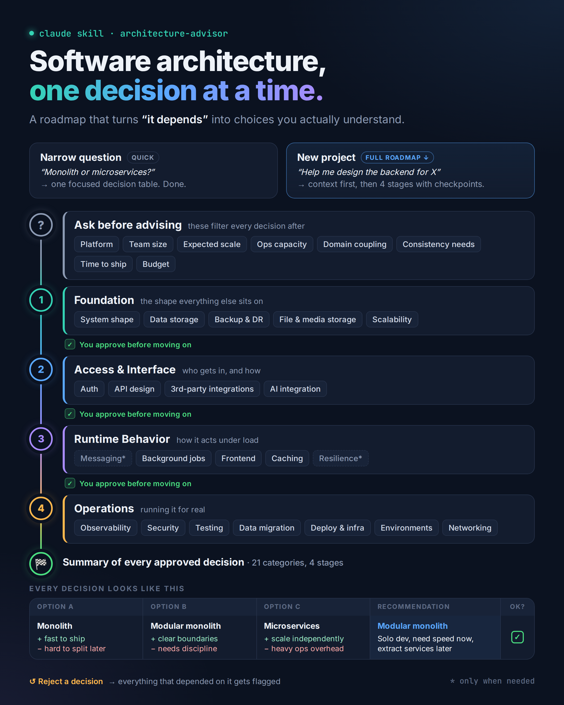

# architecture-advisor

A Claude Skill that helps developers make software architecture decisions, especially developers without much architecture experience.

<p align="center">
  <a href="architecture-advisor-roadmap.png">
    
  </a>
</p>

## What it does
- **Two modes:** a narrow question ("REST or GraphQL?") gets a focused answer. A new project gets a full, staged walkthrough.
- **Context first:** before recommending anything, it asks about platform, team size, scale, ops capacity, domain coupling, consistency needs, time-to-ship and budget.
- **21 decision categories in 4 clusters**, each approved before moving on:
  1. **Foundation:** system shape, data storage, backup & DR, file storage, scalability
  2. **Access & interface:** auth, API design, third-party integrations, AI integration
  3. **Runtime behavior:** messaging, background jobs, frontend, caching, resilience
  4. **Operations:** observability, security, testing, data migration, deployment & infra, environments & releases, networking
- **Transparent decision tables:** every decision shows the real alternatives with pros and cons, a recommendation with its reasoning, and an approval checkbox.
- **Tracks rejections:** if you reject a decision, it flags every other decision that depended on it.

## Install
1. Download this folder as a ZIP. `SKILL.md` must sit at the root of the skill folder.
2. In Claude, go to **Settings → Capabilities → Skills** and upload the ZIP.
3. Ask something like "help me design the architecture for X" or "monolith or microservices for my project?"

## Structure
```
architecture-advisor/
├── SKILL.md
└── references/   # 21 category files, numbered in dependency order
```
